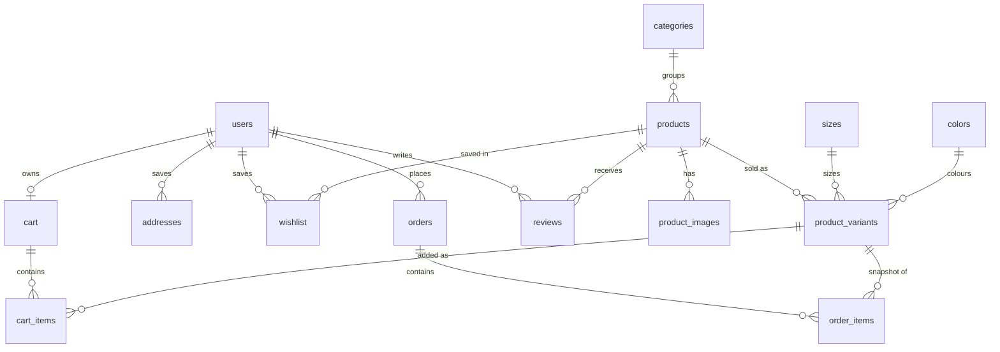
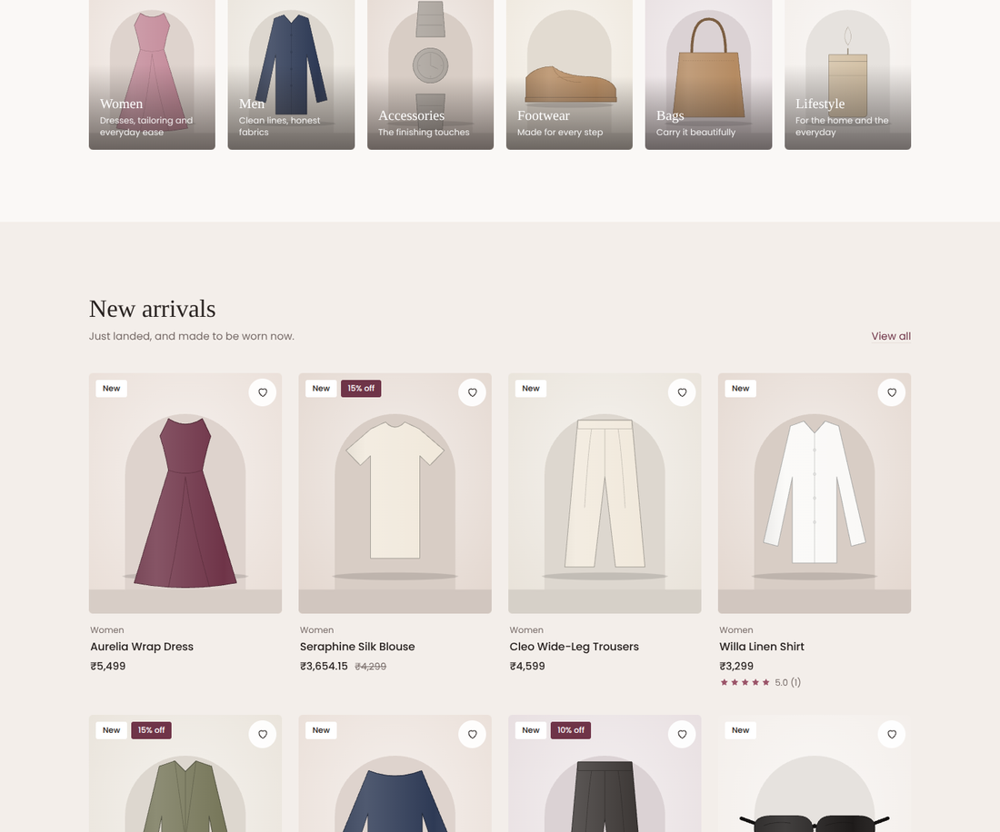
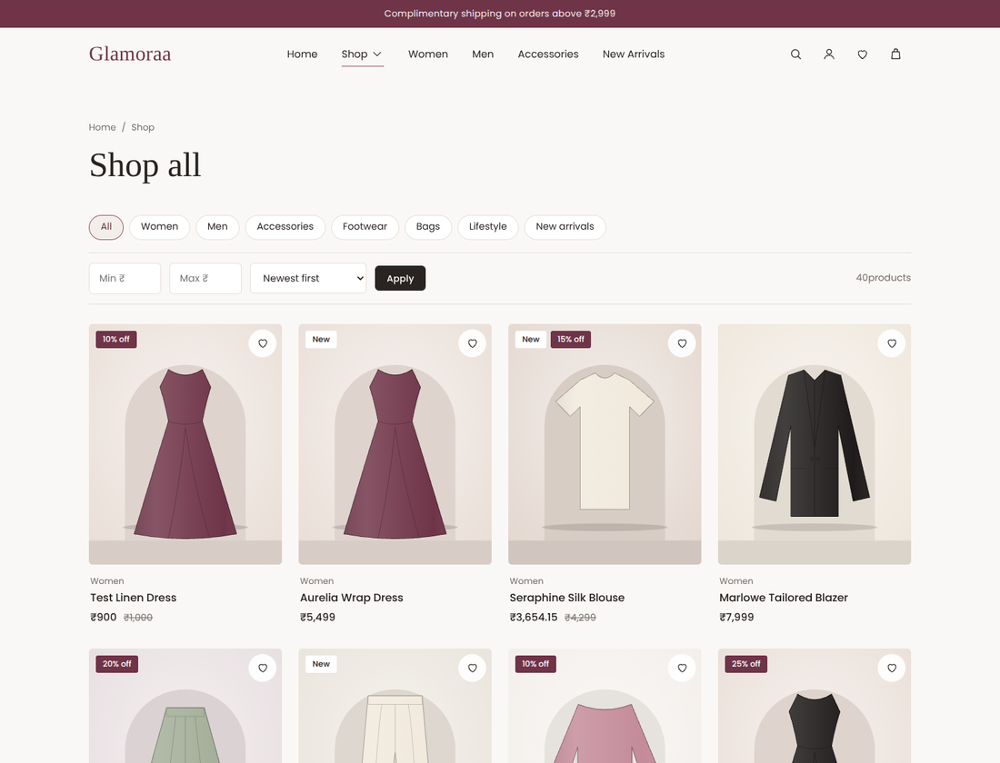
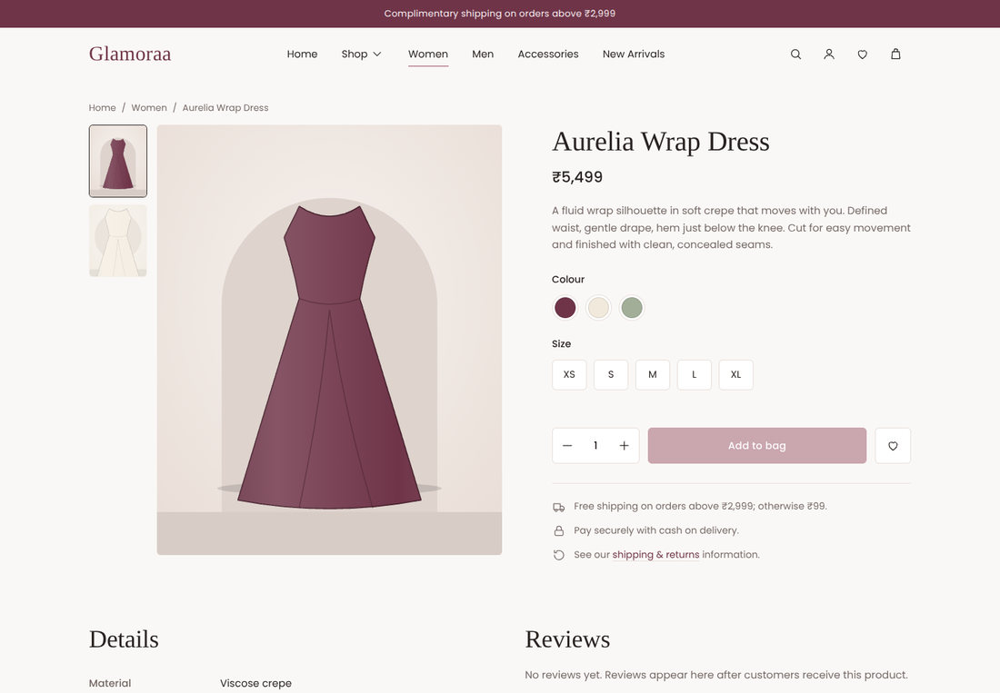
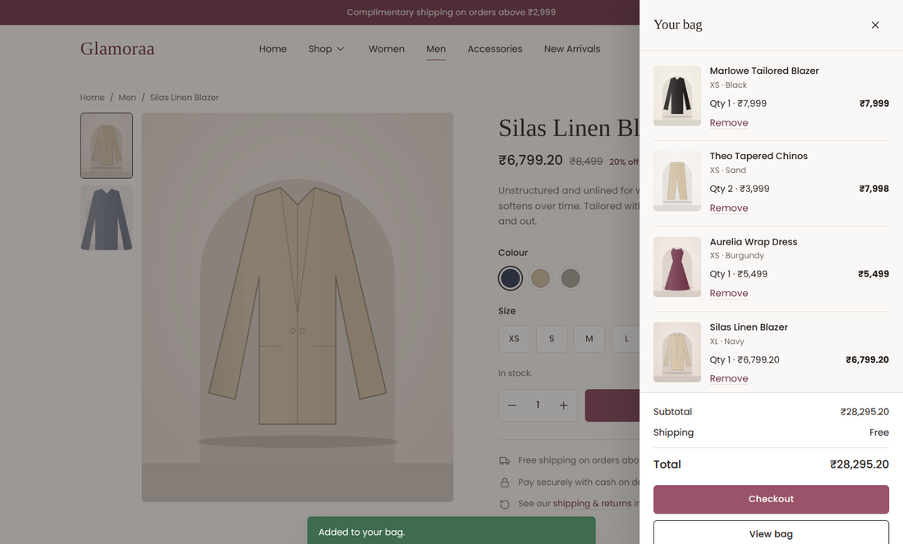
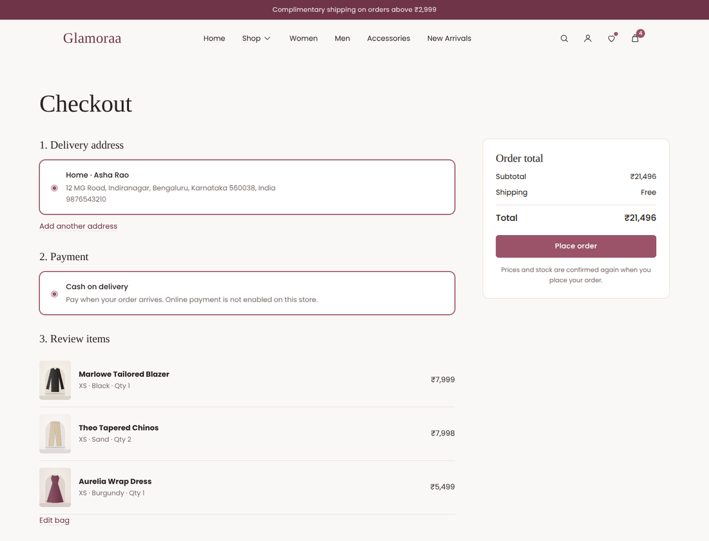
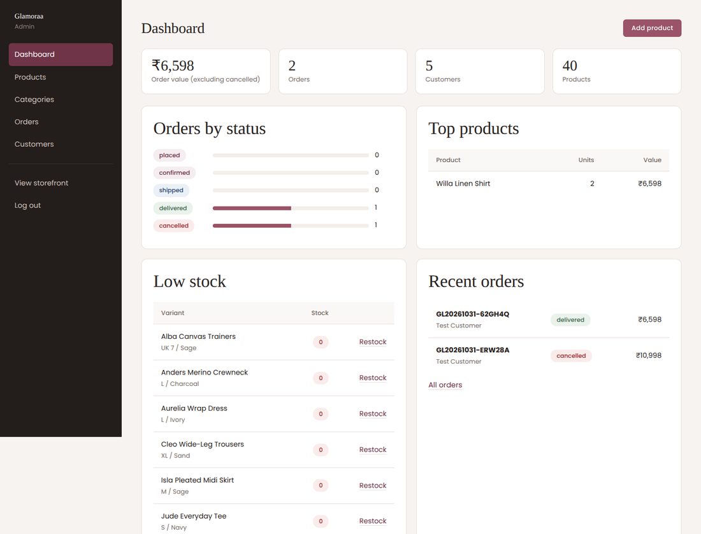
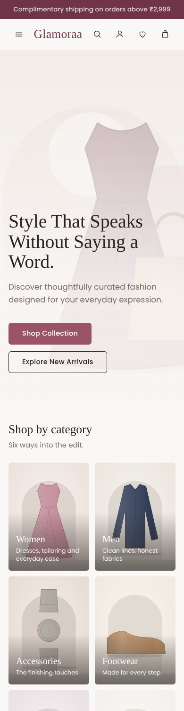

# Glamoraa

> **Discover Your Signature Style.**
> A premium fashion and lifestyle e-commerce web application built with **Java Servlets, JSP, JDBC and MySQL** - no frameworks.


Glamoraa is a complete, runnable store: a database-backed catalogue with variants and stock, customer accounts, a cart and wishlist, a transactional checkout (Cash on Delivery), order history and cancellation, and a separate admin back-office. It was built to demonstrate traditional Java full-stack engineering - MVC, DAO pattern, service layer, transactions and security - in a way that is easy to explain in an interview.

> **Demo notice.** The brand, products, prices and policies are fictional. The product "photography" is a set of generated SVG illustrations so the project works offline with no licensing issues - swap in real photos through the admin panel (see [Replacing the artwork](#replacing-the-artwork)).

---

## Contents
1. [Features](#features)
2. [Tech stack](#tech-stack)
3. [Quick start](#quick-start) (Eclipse + Tomcat 10.1 + MySQL)
4. [Configuration](#configuration)
5. [Project structure](#project-structure)
6. [Architecture](#architecture)
7. [Routes](#routes)
8. [Database](#database)
9. [Security](#security)
10. [Testing - what was and was not verified](#testing)
11. [Known limitations & future improvements](#known-limitations)
12. [Screenshots](#screenshots)

---

## Features

**Storefront**
- Editorial home page: hero, category tiles, new arrivals, featured collection, brand story, banner, best sellers, newsletter - all loaded from MySQL
- Sticky header with scroll state, animated nav underline, desktop mega-menu, slide-in mobile drawer, search overlay, cart badge, wishlist indicator
- Configurable announcement bar (the free-shipping promise is a real rule enforced at checkout)
- Catalogue with category pages, search, price range, sorting, pagination, clear-filters, shareable URLs and friendly empty states
- Product page: gallery with thumbnails + lightbox, size/colour picker driven by real variants and stock, quantity stepper, specs, related products, verified-purchase reviews
- Premium card interactions: hover image swap, quick action, animated wishlist heart, staggered scroll-reveal, toasts, skeleton/loading states, `prefers-reduced-motion` support

**Customer account**
- Register / log in / log out, profile editing, password change
- Saved addresses (add, edit, delete, default)
- Wishlist (persisted, duplicate-safe, "move to bag" with a valid variant)
- Database-backed cart with a slide-out drawer that only shows what the **server confirmed**
- Checkout -> Cash on Delivery order, confirmation page, order history, order details, self-service cancellation (stock restored exactly once)

**Admin (`/admin`)**
- Dashboard: order value, orders by status, top products, low-stock list, recent orders
- Products (create/edit/hide), categories, images (upload with signature check, or attach an existing path), sizes/colours, per-variant stock
- Orders with an enforced status workflow, customers (disable/enable)

---

## Tech stack

| Layer | Technology |
|---|---|
| Language | Java 17 |
| Web | Jakarta Servlet 6.0, JSP, JSTL 3.0 (`jakarta.tags.*`), EL |
| Server | Apache Tomcat **10.1** |
| Data | JDBC, MySQL 8.x, MySQL Connector/J 8.3 |
| Build | Maven (WAR) |
| Front end | HTML5, CSS3 (custom properties, Grid, Flexbox), vanilla JavaScript, Intersection Observer |
| Fonts | Playfair Display + Poppins (Google Fonts, with system fallbacks) |

No Spring, Hibernate/JPA, React or Node. The only libraries are JSTL and the MySQL driver.

---

## Quick start

### 1. Install
- **JDK 17 or newer** (https://adoptium.net) - check with `java -version`
- **Apache Tomcat 10.1.x** (https://tomcat.apache.org/download-10.cgi) - unzip anywhere, e.g. `C:\tomcat10`
- **MySQL 8.x** + MySQL Workbench
- **Eclipse IDE for Enterprise Java and Web Developers** (includes Maven support)

> Use **Tomcat 10.1** (Jakarta). Tomcat 9 and older use `javax.*` and will not run this project.

### 2. Create the database
`glamoraa_db` is a **new, separate** database - nothing is dropped.

In MySQL Workbench open and run, in this order:
1. `database/schema.sql`
2. `database/seed-data.sql` (run it **once**: 6 categories, 39 products, 397 variants - no users, orders or reviews)

Or from a terminal:
```bash
mysql -u root -p < database/schema.sql
mysql -u root -p < database/seed-data.sql
```

### 3. Configure credentials (never commit secrets)
Copy the example file and edit it:
```
src/main/resources/glamoraa-local.properties.example  ->  src/main/resources/glamoraa-local.properties
```
```properties
db.user=root
db.password=your_mysql_password_here
admin.bootstrap.email=admin@example.com
admin.bootstrap.password=ChooseAStrongPassword!1
```
`glamoraa-local.properties` is git-ignored. You can instead use environment variables (`GLAMORAA_DB_PASSWORD`, `GLAMORAA_ADMIN_BOOTSTRAP_PASSWORD`, ...).

On first start, if **no admin exists**, one is created from the two `admin.bootstrap.*` values. There is no default password anywhere in the code.

### 4. Import into Eclipse
1. `File -> Import -> Maven -> Existing Maven Projects` -> select the `Glamoraa` folder -> Finish. Wait for dependencies to download.
2. `Window -> Preferences -> Server -> Runtime Environments -> Add -> Apache Tomcat v10.1` -> point to your Tomcat folder. (Choose JDK 17+ as the JRE.)
3. Right-click the project -> `Run As -> Run on Server` -> choose Tomcat 10.1.
4. Open **http://localhost:8080/glamoraa/**

Check the Eclipse *Console*: you should see `Glamoraa connected to database: jdbc:mysql://localhost:3306/glamoraa_db`.

### 5. Try it
| Do this | Where |
|---|---|
| Create a customer account | `/register` |
| Browse, filter, search | `/products`, `/category/women`, `/search?q=linen` |
| Add to bag, open the drawer | any product page |
| Save an address, check out (Cash on Delivery) | `/account/addresses/new` then `/checkout` |
| Cancel an order | `/orders` |
| Admin | log in with the bootstrap admin, open `/admin` |

### Alternative: build and deploy a WAR manually
```powershell
mvn clean package                       # produces target\glamoraa.war
# Windows / PowerShell - the reliable way to redeploy:
Stop-Process -Name java -ErrorAction SilentlyContinue      # or run Tomcat's shutdown.bat
Remove-Item C:\tomcat10\webapps\glamoraa.war, C:\tomcat10\webapps\glamoraa -Recurse -Force -ErrorAction SilentlyContinue
Copy-Item target\glamoraa.war C:\tomcat10\webapps\
C:\tomcat10\bin\startup.bat
```
If port 8080 is busy: `netstat -ano | findstr :8080` then `taskkill /PID <pid> /F`.

---

## Configuration

All settings live in `src/main/resources/glamoraa.properties`. Any key can be overridden by `glamoraa-local.properties` or by an environment variable named `GLAMORAA_` + the key in upper case with dots as underscores (`db.password` -> `GLAMORAA_DB_PASSWORD`).

| Key | Purpose |
|---|---|
| `db.url`, `db.user`, `db.password`, `db.driver` | MySQL connection |
| `site.announcement` | Announcement bar text; `{freeShipping}` is replaced by the threshold. Empty hides the bar |
| `shipping.free_threshold`, `shipping.flat_fee` | Shipping rule used by cart, checkout and order creation |
| `catalog.page_size` | Products per page |
| `cart.max_quantity_per_item` | Per-line quantity cap |
| `low_stock.threshold` | Admin low-stock warning level |
| `social.*`, `contact.email` | Footer links; empty values are hidden |
| `admin.bootstrap.*` | Creates the first admin if none exists |
| `upload.dir` | Where admin uploads are stored (default `~/glamoraa-uploads`, served at `/media/`) |

---

## Project structure

```
Glamoraa/
├── pom.xml
├── README.md
├── database/            schema.sql, seed-data.sql, README.md
├── docs/                TESTING.md, PORTFOLIO.md, screenshots/
└── src/main/
    ├── java/com/glamoraa/
    │   ├── controller/  Servlets (BaseServlet + one class per feature area)
    │   ├── service/     Business rules + transactions
    │   ├── dao/         DAO interfaces      dao/impl/  JDBC implementations
    │   ├── model/       JavaBeans (User, Product, Variant, Cart, Order ...)
    │   ├── filter/      Encoding, security headers, CSRF, auth, admin, layout data
    │   ├── listener/    Startup check + admin bootstrap
    │   └── util/        Db, Jdbc helper, Tx, PasswordUtil, Csrf, Validator, Money ...
    ├── resources/       glamoraa.properties (+ local example)
    └── webapp/
        ├── assets/      css/, js/, images/ (generated SVG art), icons/
        └── WEB-INF/
            ├── views/       JSP pages (home, product, cart, checkout, orders, admin ...)
            ├── fragments/   header, footer, cart drawer, toast
            ├── tags/        layout, productCard, pagination, field, icon ... (tag files)
            ├── tld/         EL functions (money, img)
            └── web.xml      filter order, sessions, error pages
```
JSPs sit under `WEB-INF`, so they can only be reached through a controller.

---

## Architecture

```
Browser -> Filters -> Servlet (controller) -> Service -> DAO -> JDBC -> MySQL
                         |                       |
                         +------ JSP (view) <----+  (request attributes only)
```
- **Controllers** read and validate request parameters, call one service method, then forward to a JSP or redirect (Post/Redirect/Get after every successful POST). They contain no SQL and no business rules.
- **Services** own the rules and the **transaction boundary** via `Tx.read()` / `Tx.write()` (commit on success, roll back on any exception).
- **DAOs** are interfaces with JDBC implementations. Every statement is a `PreparedStatement`; the tiny `Jdbc` helper closes everything with try-with-resources.
- **Views** use JSTL/EL only and escape user data with `<c:out>`. Shared markup lives in tag files (`layout`, `productCard`, ...) and fragments.
- **Errors:** `BusinessException` (safe message for customers), `FormException` (per-field messages), `NotFoundException` (404), `DataAccessException` (logged server-side, generic 500 page).

### Interesting engineering details (good interview talking points)
- **Pricing is computed in one place.** `products.sale_price` is a generated column (`ROUND(price * (100 - discount_percent) / 100, 2)`), so listing, sorting, cart and order totals always agree. Discounts are *percentages*.
- **Checkout is one transaction.** Variant rows are locked in id order (`SELECT ... FOR UPDATE`, no deadlocks), prices and stock are re-read under the lock, stock is decremented with a conditional `UPDATE ... WHERE stock_quantity >= ?`, then the order, snapshot lines and cart clearing are committed together - or everything rolls back.
- **Duplicate submissions** are blocked twice: a one-time checkout token in the session, and a `UNIQUE` idempotency key on `orders`.
- **Cancellation restores stock exactly once** using compare-and-set status changes plus a `stock_restored` flag.
- **Order lines are snapshots** (name, SKU, size, colour, price, address), so history never changes when the catalogue does.
- **Variant validation:** the server checks that the submitted variant belongs to the submitted product, is active and in stock; prices and totals from the browser are never read.
- **Search/sort safety:** `LIKE` input is escaped, sort keys go through an allowlist map, page numbers are clamped.

---

## Routes

| Method | URL | Controller | Auth |
|---|---|---|---|
| GET | `/`, `/home` | HomeServlet | - |
| GET | `/products`, `/category/{slug}`, `/search?q=` | CatalogServlet | - |
| GET | `/product?id=` | ProductDetailServlet | - |
| POST | `/product/review` | ReviewServlet | customer |
| GET/POST | `/about` `/contact` `/shipping-returns` `/privacy` `/terms` | PageServlet | - |
| POST | `/newsletter` | NewsletterServlet | - |
| GET/POST | `/login`, `/register` | LoginServlet, RegisterServlet | - |
| POST | `/logout` | LogoutServlet | - |
| GET | `/forgot-password` | ForgotPasswordServlet (reports "not configured") | - |
| GET | `/account` | AccountServlet | customer |
| GET/POST | `/account/profile` | ProfileServlet | customer |
| GET | `/account/addresses`, `/new`, `/edit?id=` | AddressServlet | customer |
| POST | `/account/addresses/save`, `/delete`, `/default` | AddressServlet | customer |
| GET | `/wishlist` | WishlistServlet | customer |
| POST | `/wishlist/add`, `/remove`, `/toggle`, `/move` | WishlistActionServlet | customer |
| GET | `/cart`, `/cart/summary` (JSON) | CartServlet, CartActionServlet | customer |
| POST | `/cart/add`, `/update`, `/remove`, `/clear` | CartActionServlet | customer |
| GET | `/checkout` | CheckoutServlet | customer |
| POST | `/place-order` | PlaceOrderServlet | customer |
| GET | `/orders`, `/order-details?id=`, `/order-confirmation?id=` | OrderServlet | customer |
| POST | `/order-cancel` | OrderServlet | customer |
| GET | `/admin`, `/admin/dashboard` | AdminDashboardServlet | admin |
| GET/POST | `/admin/products`, `/new`, `/edit`, `/save`, `/toggle` | AdminProductServlet | admin |
| GET/POST | `/admin/images?productId=` | AdminImageServlet | admin |
| GET/POST | `/admin/variants?productId=` | AdminVariantServlet | admin |
| GET/POST | `/admin/categories` | AdminCategoryServlet | admin |
| GET/POST | `/admin/orders`, `/view?id=`, `/status` | AdminOrderServlet | admin |
| GET/POST | `/admin/customers` | AdminCustomerServlet | admin |
| GET | `/media/{file}` | MediaServlet (uploaded images) | - |
| any | `/error` | ErrorServlet | - |

Every state-changing route is POST-only and CSRF-protected.

---

## Database

`database/schema.sql` creates 16 InnoDB tables with primary keys, foreign keys, unique constraints, indexes and `DECIMAL` money columns:


Plus `newsletter_subscriptions` and `contact_messages`. Stock is stored per variant (size + colour). See `database/README.md` for details and troubleshooting.

---

## Security

| Concern | Approach |
|---|---|
| Passwords | PBKDF2-HMAC-SHA256, 210,000 iterations, random salt, constant-time compare (JDK built-in - no extra dependency) |
| Login | Generic error message, timing-equalised unknown-email path, 5-failure lockout per IP+email, new session id on login |
| Sessions | HttpOnly + `SameSite=Lax` cookie, 30 min timeout, logout invalidates the session |
| CSRF | Per-session token required on every POST (hidden field or `X-CSRF-Token` header) |
| AuthZ | `AuthFilter` for customer routes; `AdminFilter` re-checks the user's role **in the database** on every `/admin/*` request. Identity always comes from the session, never from a form field |
| Ownership | Cart items, addresses and orders are queried by `(id, session user)`; other users get 404 |
| Injection | `PreparedStatement` everywhere, allowlisted sort columns, escaped `LIKE` |
| XSS | `<c:out>` on all user data, strict CSP (`script-src 'self'`, no inline JS) |
| Open redirect | `next` parameters must be same-site relative paths |
| Uploads | Size limit, file type decided by magic bytes (not file name), random server-side names, stored outside the WAR, no SVG uploads |
| Headers | CSP, `X-Content-Type-Options`, `X-Frame-Options`, `Referrer-Policy`, `Permissions-Policy` |
| Secrets | Config via git-ignored file or environment variables; no keys in source |
| Errors | Friendly pages; stack traces and SQL only in server logs |

Add `<secure>true</secure>` to the session cookie in `web.xml` and serve over HTTPS in production.

---

## Testing

See [`docs/TESTING.md`](docs/TESTING.md) for the full manual checklist and the exact record of what was run.

**What was actually run while building this project** (in a Linux sandbox):
- The Java sources compile cleanly with `javac` against the Tomcat 10.1 Servlet API.
- The app was deployed to **Apache Tomcat 10.1.55** and a scripted integration suite of **104 checks passed** against a clean database: registration, login/logout, duplicate email, role-escalation attempt, CSRF rejection, open-redirect block, cart merge/limits/tampered variants/cross-user ownership, wishlist, address ownership, checkout totals, stock decrement, duplicate-submission block, oversell rollback, cancellation + single stock restore, admin route protection, product/variant/category/image management, upload validation, order status workflow, verified reviews, newsletter and contact.
- Pages were rendered in headless Chromium at 1440, 1024, 768, 390 and 360 px: **no horizontal overflow and no JavaScript errors**; cart drawer, wishlist heart and mobile menu were exercised.

**What was NOT run** (please verify on your machine):
- The sandbox used **MariaDB 10.11** (MySQL-compatible) with the MariaDB JDBC driver, not MySQL 8 with Connector/J. The SQL sticks to features both support, but run the checklist once on MySQL 8.
- **`mvn package` was not executed** (the sandbox could not reach Maven Central). The `pom.xml` uses standard coordinates; the same sources were compiled with `javac` and the JSPs were run on Tomcat with a Jakarta-converted JSTL.
- No automated unit tests (JUnit) are included.
- Real fonts load from Google Fonts; the sandbox was offline, so rendering used the fallback fonts.

---

## Known limitations

- **Payments:** Cash on Delivery only. The `PaymentService` is the integration point for a gateway such as Razorpay TEST mode (server-side order, signature verification, status tracking) - it is deliberately *not* faked.
- **Email:** none is configured, so password reset is reported as unavailable, and contact/newsletter submissions are stored in MySQL only.
- **Pooling:** connections use `DriverManager` for simplicity; use a Tomcat JNDI `DataSource` or HikariCP for production load.
- Disabling a customer blocks new logins; an already-open session lasts until it expires.
- Artwork is generated illustration, not photography. Refunds/returns are policy text only (no returns workflow).
- Single currency (INR) and a single flat shipping rule.

## Future improvements
Razorpay sandbox integration, email delivery (order confirmations, password reset), returns/refunds, coupon codes, product variants with per-size pricing, full-text search, HikariCP, JUnit/integration tests in CI, Docker Compose for Tomcat + MySQL, i18n, and an audit log for admin actions.

---

## Replacing the artwork
1. Admin -> Products -> **Images** -> upload JPG/PNG/WebP (3 MB max) and mark one as primary.
2. Category tiles and the hero are plain files under `src/main/webapp/assets/images/` - replace them, or change a category's image path under Admin -> Categories.
3. Recommended product image ratio: 4:5 (for example 1200 x 1500 px), compressed to well under 300 KB.

## Screenshots
| | |
|---|---|
|  |  |
|  |  |
|  |  |
|  |  |

*Screenshots were captured from the test environment with fallback fonts.*
